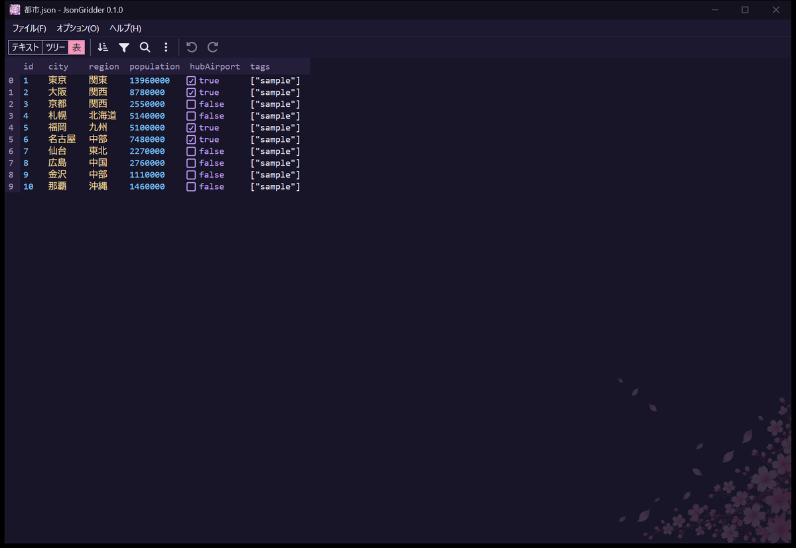
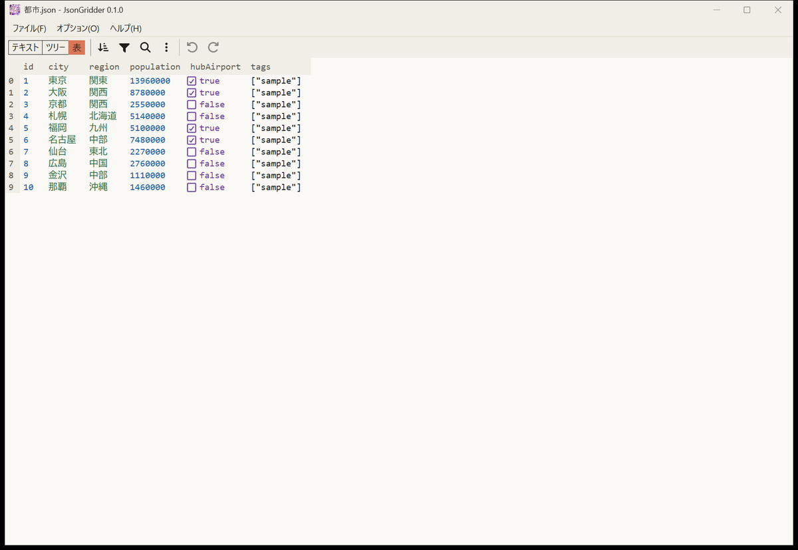

🇬🇧 [English README / 英語版 README](README.md)

# JsonGridder

**JSON ファイルを Excel のような表で見て直せる。** Windows 用の無料のアプリです。インストール不要で、英語と日本語に対応しています。



## できること
- **表、ツリー、テキストの 3 つの表示**で同じ文書を扱えます。オブジェクトの配列は表で開き、内側のどの配列を表にするかも選べます。
- **表計算ソフトのように編集**できます。セルを選んで打ち、Enter で確定、Ctrl+Z と Ctrl+Y で元に戻す、やり直す。
- **検索と置換**（Ctrl+F、Ctrl+H）。1 件ずつでも、すべてまとめてでも置換できます。すべて置換は Ctrl+Z 1 回で元に戻ります。
- **並べ替え、絞り込み、クエリによる変換**。
- **編集していない部分はそのまま**: 字下げ、改行コード、`1.0` や長い ID のような数値の書き方を保ちます。保存は途中で壊れない形で行い、ディスク上で書き換えられたファイルを上書きする前には確認します。
- **未保存の変更を黙って失いません**: 閉じる、別のファイルを開く、終了するときに確認します。
- **ダークとライト**、**英語と日本語**（オプションのメニュー）。起動したときは英語です。日本語は Options のメニューで選びます。
- **右端で折り返す**（オプションのメニュー）: 表のセルの長い文字を列の幅の中で折り返し、行を 2 行、3 行と増やして表示します。横にスクロールしなくても全文が読めます。一番右の列は窓の右端まで広がります。列の見出しの境目をドラッグすると、列の幅を変えられます。変わるのは表示だけで、ファイルは変わりません。
- **インストール不要**: EXE が 1 つだけです。設定は EXE の隣に保存します。
- アプリ自身は**ネットワークに接続しません**。



English の操作ガイド: [docs/guide.md](docs/guide.md)

## ダウンロード
1. [Releases](../../releases) のページから `JsonGridder-<版>-windows-x64.zip` をダウンロードします。
2. ZIP には `JsonGridder.exe`、README、`LICENSE`、`THIRD_PARTY_NOTICES.md` が入っています。
3. ZIP を好きなフォルダに展開し、`JsonGridder.exe` を起動します。インストールは要らず、管理者の権限も要りません。

EXE にはコード署名が無いため、初回に Windows の SmartScreen が「Windows によって PC が保護されました」と出すことがあります。**詳細情報** を押してから **実行** を押してください。スマート アプリ コントロールが有効な PC では起動できません。

ダウンロードしたファイルが壊れていないかは、リリースのページに載せた SHA-256 と比べて確かめられます。PowerShell で次を実行します。

```powershell
Get-FileHash .\JsonGridder-<版>-windows-x64.zip -Algorithm SHA256
```

## 使い方
1. `JsonGridder.exe` を起動します。最初は英語で表示されます。日本語にするには **Options > Language > 日本語** を選びます。
2. **ファイル > 開く**、窓へのドロップ、またはコマンドラインでファイルを開きます。

   ```text
   JsonGridder.exe "C:\path\to\file.json"
   ```

Windows 11 には、アプリが使う WebView2 ランタイムが標準で入っています。無い場合は、理由を表示して終了します。

### .json を JsonGridder で開く
アプリはファイルの関連付けを変えません。使いたいときは、`.json` ファイルを右クリックして **プログラムから開く > 別のプログラムを選択** を選び、`JsonGridder.exe` を指定してください。

## 設定
EXE の隣に `JsonGridder.settings.json` ができます。テーマ、言語、最近開いたファイル、窓の位置を、手で直せる JSON で持ちます。EXE と一緒に移せば設定も付いてきます。最近開いたファイルのパスはそのまま書かれます。フォルダに書き込めないときも動作し、設定を保存できないことを知らせます。

`language`（省略可、`"en"` か `"ja"`、既定 `"en"`）は、**オプション > 言語** の設定です。無いときや、どちらでもない値のときは、Windows の表示言語に関係なく英語になります。

`splashMs`（省略可、既定 `1500`）は、アプリを直接起動したときに起動画面を出しておく最短の時間（ミリ秒）です。`0` にすると起動画面を出しません。ファイルをダブルクリックして開いたときや、引数でファイルを渡したときは出ません。

`splashCeremony`（省略可、既定 `true`）は、起動画面を次の起動で出すかどうかです。起動画面を出すと、アプリが `false` に書き換えるので、通常は初回の 1 回だけ出ます。`true` に戻すと、次の起動でもう一度出ます。起動の準備が長引くときは、`false` でも起動画面を出します。

`wrapLines`（省略可、既定 `false`）は、**オプション > 右端で折り返す** の設定です。

## 削除
1. `JsonGridder.exe` と `JsonGridder.settings.json` を削除します。
2. WebView2 の作業フォルダ `%LOCALAPPDATA%\io.github.vtriot.jsongridder` を削除します。

## 既知の制限
- アプリや PC の異常終了、Windows のシャットダウンやサインアウトでは、未保存の編集は失われます。自動の復元はありません。
- 表やツリーで編集すると、文書全体を一定の書式で書き直します。値とキーの順序は保ちますが、1 行にまとめた書き方やエスケープの書き方は戻りません。
- `"1"`、`"10"` のような数字のキーを持つ文書は、編集するとキーの順序が JavaScript と同じ順に変わります。
- 保存するとハードリンクは切れます。
- 列の見出しでの並べ替えはデータそのものを並べ替えます。数値は数値の順になりません。
- 変換（Transform）は数値を書かれたとおりに保ち、丸める代わりに理由を出して止まります。たとえば、正確に保てない大きな数での計算や、結果のキーがぶつかるクエリです。小数の計算は通常の浮動小数点で行います（`0.1 + 0.2` は `0.30000000000000004`）。
- 重複したキー、または `__proto__`、`constructor` のキーを持つ文書は、テキストの表示でだけ開けます。
- セルで `[` や `{` を打つと、文字として入力が始まります。配列やオブジェクトはメニューから挿入します。
- WebView2 は自身の設定に従って Microsoft へ診断データを送ることがあります。アプリからは止められません。

## 使っているもの
JsonGridder は [Tauri](https://tauri.app/) と、Jos de Jong 氏の [svelte-jsoneditor](https://github.com/josdejong/svelte-jsoneditor)（JSON Editor Online のエンジン）のエディタで作っています。

## ライセンス
JsonGridder は [MIT ライセンス](LICENSE) で公開しています。

アプリには第三者の部品が入っており、それぞれのライセンスに従います。名前、版、著作権表示、ライセンスの全文は [THIRD_PARTY_NOTICES.md](THIRD_PARTY_NOTICES.md) にあります。
