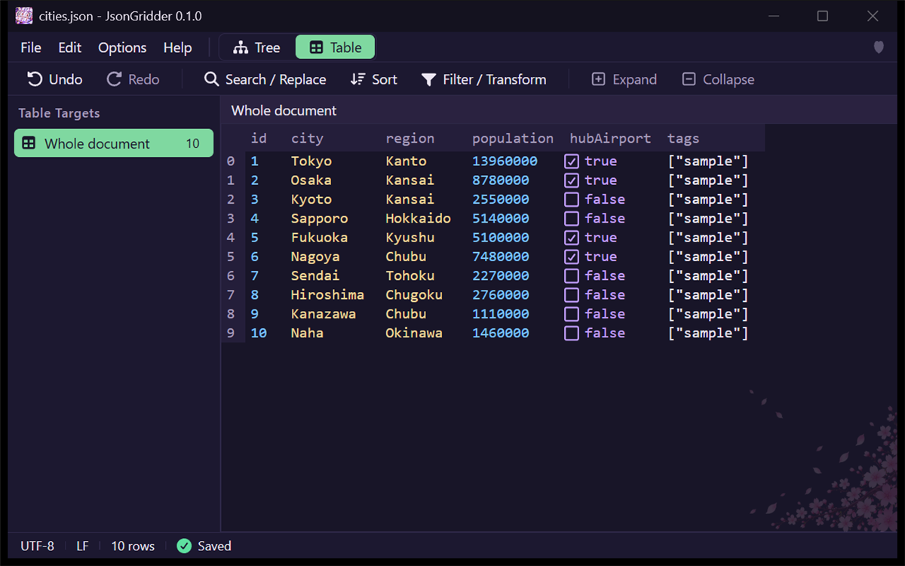
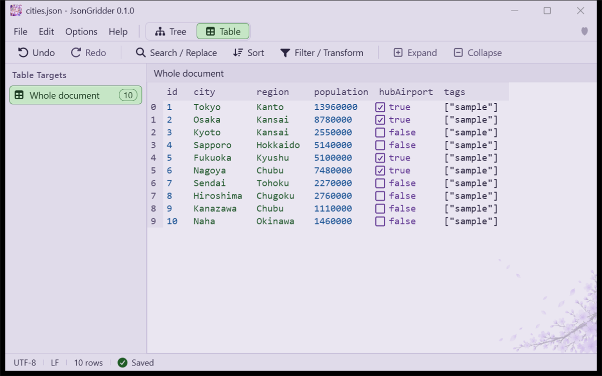

🇯🇵 [日本語版 README はこちら / Japanese README](README.ja.md)

# JsonGridder

**View and edit JSON files in an Excel-like table.** A free, portable app for Windows, in English and Japanese.



## Features
- **Tree and Table views** of the same document. Files open in the Tree view; switch with the **Tree** and **Table** buttons at the right of the menu bar.
- **Table targets in the left pane**: the arrays in the document that can be shown as a table are listed with their item counts. Click one to show it as the table. **Options > Hide Table Targets in Tree View** hides the pane while the Tree view is shown.
- **Two-level column headers**: columns of nested objects such as `address.city` are grouped under `address`, with `city` in the second row.
- **Command row** under the menu bar: Undo, Redo, Search / Replace, Sort, Filter / Transform, Expand, and Collapse.
- **Edit like a spreadsheet**: click a cell and type, press Enter to commit, Ctrl+Z / Ctrl+Y to undo and redo. The **Edit** menu has Undo, Redo, Cut, Copy, Paste, Find / Replace, and **Open in Text Editor**, which opens the file in the Windows default app for `.txt` files.
- **Documents that the table and tree cannot hold** (invalid JSON, duplicate keys, the keys `__proto__` or `constructor`, or nesting that is too deep) open as plain text with a warning band that gives the reason and the line. When you fix the text, the Tree and Table buttons become available again.
- **Files changed by another app are reloaded** when you come back to the window. If you have unsaved changes, the app asks whether to reload or keep your edits.
- **Status row** at the bottom: the character encoding, the line endings, the number of rows (Table view), and whether the document is saved.
- **Translation (off by default)**: right-click a column header, a table cell, or a text value in the tree, point to **Translate to English**, and choose **Paid** or **Free** in its submenu (日本語に翻訳 > 有料 / 無料 in the Japanese UI). You choose for each translation: the paid key for confidential documents, the free-tier key for documents Google may use. The translations appear in a side panel next to the originals, where you can copy them. Your JSON is not changed unless you choose **Add translations as a new column**, which one Undo takes back. See [Translation](#translation).
- **Search and replace** (Ctrl+F, Ctrl+H), one match at a time or all at once. One Ctrl+Z undoes a whole Replace All.
- **Sort, filter, and transform** with queries.
- **Your file stays as it was where you did not edit it**: the indentation, line endings, and number formats such as `1.0` or long IDs are kept. Saving is atomic, and the app asks before overwriting a file that changed on disk.
- **Unsaved changes are never lost silently**: closing, opening another file, or exiting asks you first.
- **Dark and light themes**, and **English and Japanese** (Options menu). The app starts in English; choose Japanese in the Options menu.
- **Wrap at Window Edge** (Options menu): long text in a table cell wraps onto more lines within the column width, so you can read it without scrolling sideways. The last column reaches the right edge of the window. Drag the border between column headers to change a column's width. This changes only the display, not your file.
- **Portable**: one EXE, no installer. Settings are stored next to the EXE.
- **The app itself makes no network access unless you enable translation.** With translation off (the default), JsonGridder sends nothing. The Microsoft Edge WebView2 Runtime that draws the window is a Windows component and may contact Microsoft services on its own.



See the [user guide](docs/guide.md) for step-by-step instructions with screenshots.

## Download
1. Open the [Releases](../../releases) page and download `JsonGridder-<version>-windows-x64.zip`.
2. The ZIP contains `JsonGridder.exe`, this README, `LICENSE`, and `THIRD_PARTY_NOTICES.md`.
3. Extract the ZIP to any folder and run `JsonGridder.exe`. There is no installer, and you do not need administrator rights.

The EXE is not code-signed, so Windows SmartScreen may show "Windows protected your PC" the first time. Click **More info**, then **Run anyway**. On PCs with Smart App Control turned on, the app cannot start.

To check that the download is intact, compare its SHA-256 hash with the one published on the release page. In PowerShell:

```powershell
Get-FileHash .\JsonGridder-<version>-windows-x64.zip -Algorithm SHA256
```

## Getting started
1. Run `JsonGridder.exe`. It starts in English. To use Japanese, choose **Options > Language > 日本語**.
2. Open a file with **File > Open**, by dropping a file on the window, or from the command line:

   ```text
   JsonGridder.exe "C:\path\to\file.json"
   ```

Windows 11 includes the WebView2 runtime that the app needs. If it is missing, the app shows the reason and exits.

### Open .json files with JsonGridder
The app does not change your file associations. To choose it yourself, right-click a `.json` file, select **Open with > Choose another app**, and browse to `JsonGridder.exe`.

## Settings
`JsonGridder.settings.json` is created next to the EXE. It holds the theme, the language, the recent files, and the window position, as readable JSON that you can edit. Move it together with the EXE and your settings move too. Recent files are stored as plain paths. If the folder is not writable, the app still works and tells you that settings cannot be saved.

`language` (optional, `"en"` or `"ja"`, default `"en"`) is **Options > Language**. If it is missing or not one of these values, the app uses English, whatever the Windows display language is.

`splashMs` (optional, default `1500`) is the minimum time in milliseconds the start-up screen stays up when you launch the app directly. Set it to `0` to turn the start-up screen off. It is not shown when a file is opened by double-click or passed as an argument.

`splashCeremony` (optional, default `true`) controls whether the start-up screen is shown on the next launch. When the start-up screen is shown, the app rewrites it to `false`, so normally it appears only on the first launch. Set it back to `true` to see it again on the next launch. If start-up preparation is still pending, the start-up screen is shown even when it is `false`.

`wrapLines` (optional, default `false`) is **Options > Wrap at Window Edge**.

`hideTargetsInTree` (optional, default `false`) is **Options > Hide Table Targets in Tree View**. When it is `true`, the left pane that lists the arrays you can show as a table is hidden while the Tree view is shown. The pane still appears in the Table view.

`translationEnabled` (optional, default `false`), `translationService` (`"gemini"`), `translationModel` (default `"gemini-3.1-flash-lite"`), `translationFallback` (optional, default `true`), `translationConfirm` (optional, default `true`), and `translationMachineNotice` (optional, default `true`) are **Options > Translation Settings...**. Values that are not allowed fall back to the defaults. The API key is never written to this file. A `translationTier` written by an earlier version is read but not used (you choose free tier or paid for each translation).

## Translation
Translation is off until you turn it on. While it is off, nothing is sent anywhere.

1. Get an API key for the Gemini API from Google AI Studio.
2. Choose **Options > Translation Settings...**, turn on **Enable translation**, paste a key, and choose **Save Key** and **Save**. There are two key fields: put a key from a project without billing in **Free-tier key (project without billing)**, and a key from a project with billing enabled in **Paid key (project with billing)**. One of them is enough.
3. Right-click a column header, a table cell, or a text value in the tree, point to **Translate to English**, and choose **Paid** or **Free** in its submenu (in the Japanese UI, 日本語に翻訳 > 有料 / 無料). The submenu lists only the keys you saved, even if there is just one; Paid and Free are shown in different text colors. With no key saved, **Translate to English** has no submenu and opens Translation Settings. From the keyboard, Right Arrow or Enter opens the submenu, and Left Arrow or Esc closes it. The target language is the UI language.
4. Before anything is sent, the app shows how many values and characters will be sent, to which service and model, and whether the free-tier or the paid key is used. Only text values are sent: numbers, true/false, null, and empty strings are not. **Cancel** is the default button. If you check **Don't show again** and choose **Send**, later translations are sent without this confirmation. Turn it back on with **Confirm before sending** in **Options > Translation Settings...**.

The results appear in the side panel with the originals. You can copy one translation, all translations, or the originals and translations as tab-separated lines. The panel also says whether the free-tier or the paid key was used. If translation stops partway, the rows translated so far are kept, and **Translate the rest** sends only the remaining ones, with the same key. The note at the top of the panel that translations are machine guesses has a **Don't show again** button; turn the note back on with **Show the note in the result panel** in **Options > Translation Settings...**. When you translated a column, **Add translations as a new column** adds a new key next to the original (for example `subject_en`, or `subject_ja` when translating to Japanese) in one edit that one Undo takes back. It never overwrites an existing key or changes the original values.

**When a model is busy.** If the chosen model stays busy or keeps hitting its rate limit after a few retries, and **Switch to another model when the model is busy** is on (the default) in **Options > Translation Settings...**, the rest is sent with the next model in the list, for that translation only. The saved model does not change, and the panel shows which model produced the translations (for example "Model used: gemini-3.5-flash-lite (because gemini-3.1-flash-lite was busy)"). The app does not switch models for a wrong key, a refused permission, a safety refusal, or an unreadable response. When translation stops, the panel says what went wrong and what to do, with Google's own message under it.

**Free tier or paid API.** On the Gemini API free tier, Google uses the text you send and the translations to improve its products, and people may read them, according to Google's terms. Translate values that contain confidential or personal information with the paid key. On the paid API (a key from a Google Cloud project with billing enabled), they are not used to improve Google's products. Whether a request counts as free tier or paid is decided by Google from whether billing is enabled for the key's project, not by anything this app sends. That is why the app keeps two keys and sends with the one you chose in the right-click menu. If you put a key from a project with billing in the free-tier field, those translations are billed as paid. In the EEA, Switzerland, and the UK, only the paid API may be used. See Google's [Gemini API terms](https://ai.google.dev/gemini-api/terms) and [pricing](https://ai.google.dev/gemini-api/docs/pricing).

**Where the keys are kept.** The API keys are stored in the Windows Credential Manager as generic credentials, not in the settings file: `JsonGridder/translation/gemini/free` for the free-tier key and `JsonGridder/translation/gemini/paid` for the paid key. They are not shown on screen after they are saved. A key saved by an earlier version (`JsonGridder/translation/gemini`) appears in Translation Settings as **Earlier key (choose where to move it)**. It is not assigned to either tier, and not used for translation, until you choose **Move to Free-Tier Key** or **Move to Paid Key**. Moving writes the key to the new place, reads it back, and only then deletes the earlier key. A key that is already saved in the new place is never overwritten.

**What is sent, and from where.** Only when translation is enabled and you confirm (or have turned the confirmation off), the app sends the text values to `generativelanguage.googleapis.com` over HTTPS. The request is made by the app itself (its Rust side), not by the window's web content, which is not allowed to connect to the internet.

## Uninstall
1. Delete `JsonGridder.exe` and `JsonGridder.settings.json`.
2. Delete the WebView2 working folder `%LOCALAPPDATA%\io.github.vtriot.jsongridder`.
3. If you saved an API key for translation, delete it with **Delete Key** in **Options > Translation Settings...** before you delete the EXE, or delete `JsonGridder/translation/gemini/free`, `JsonGridder/translation/gemini/paid`, and the earlier `JsonGridder/translation/gemini` under **Windows Credentials** in the Windows Credential Manager.

## Known limitations
- If the app or the PC crashes, or Windows shuts down or signs out, unsaved edits are lost. There is no automatic recovery.
- After you edit in the table or the tree, the whole document is written again in a consistent style. Values and key order are kept, but inline layout and how escapes were written are not.
- In documents with numeric keys such as `"1"`, `"10"`, the key order changes when edited, as in JavaScript.
- Saving breaks hard links.
- Sorting by a column header sorts the data itself, and it does not sort numbers numerically.
- Transform keeps numbers exactly as written, and stops with a reason instead of rounding: for example, calculations with numbers too large to hold exactly, or queries whose result keys collide. Decimal calculations use standard floating point (`0.1 + 0.2` gives `0.30000000000000004`).
- Documents with duplicate keys, or with the keys `__proto__` or `constructor`, open only as plain text, until you fix them.
- Translations are machine output and can be wrong. Check them against the originals before you use them.
- Typing `[` or `{` in a cell starts typing text. To insert an array or object, use the menu.
- WebView2 may send diagnostic data to Microsoft according to its own settings. The app cannot turn this off.

## Built with
JsonGridder is built with [Tauri](https://tauri.app/) and the editor of [svelte-jsoneditor](https://github.com/josdejong/svelte-jsoneditor) by Jos de Jong, the engine behind JSON Editor Online.

## License
JsonGridder is released under the [MIT License](LICENSE).

The app includes third-party components, each under its own license. Their names, versions, copyright notices, and license texts are in [THIRD_PARTY_NOTICES.md](THIRD_PARTY_NOTICES.md).
