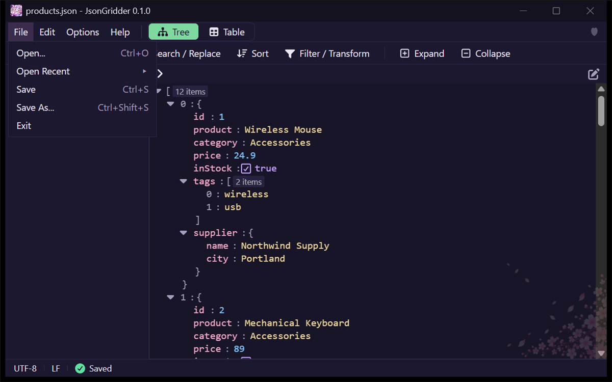
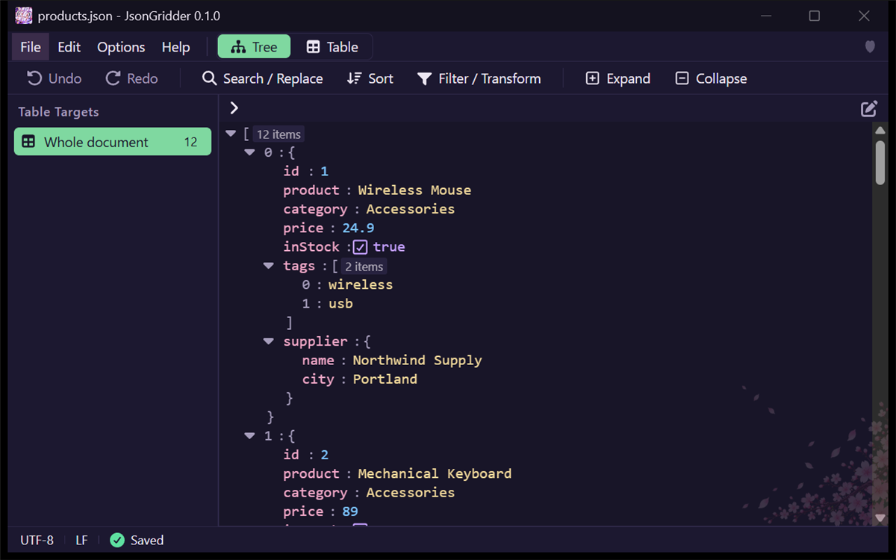
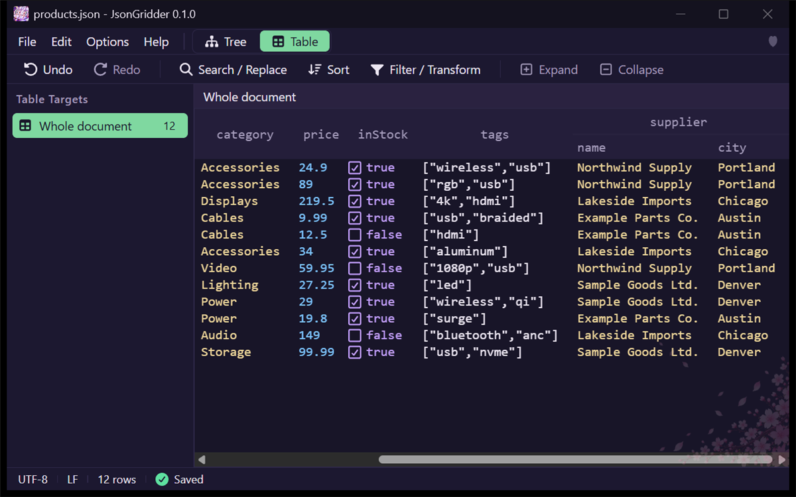
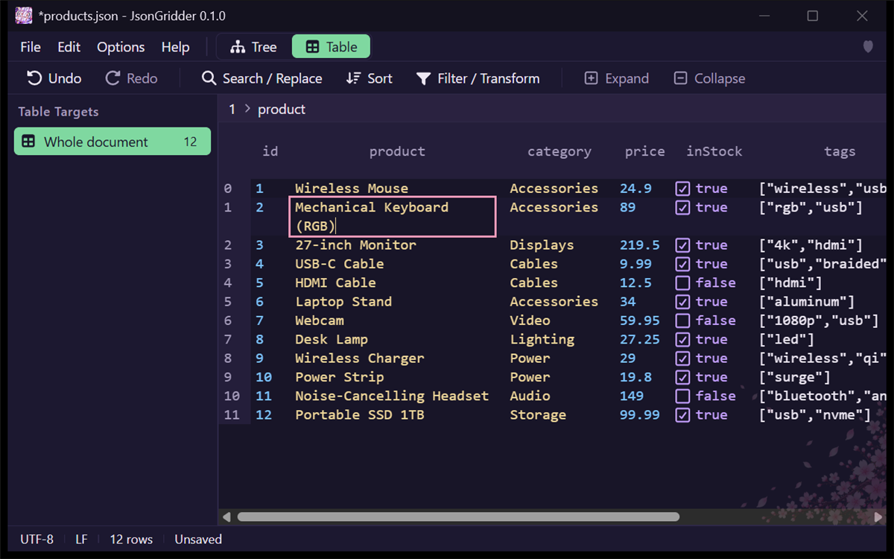
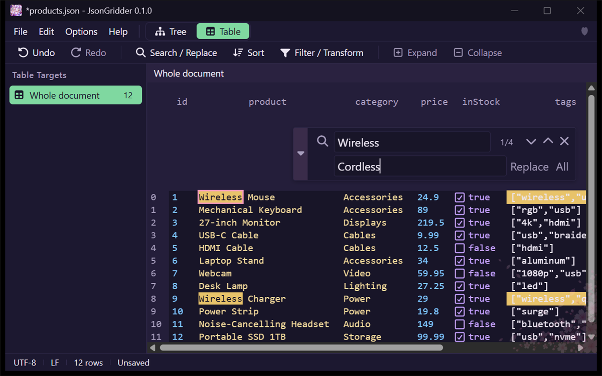
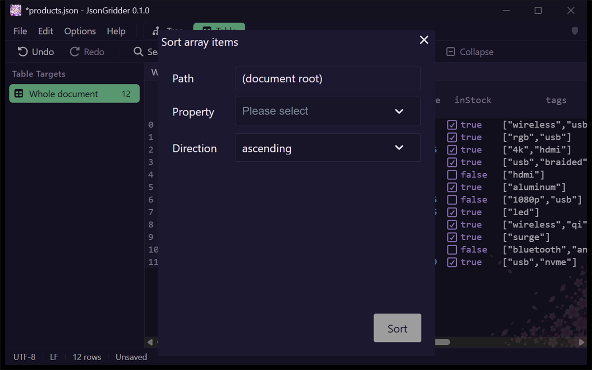
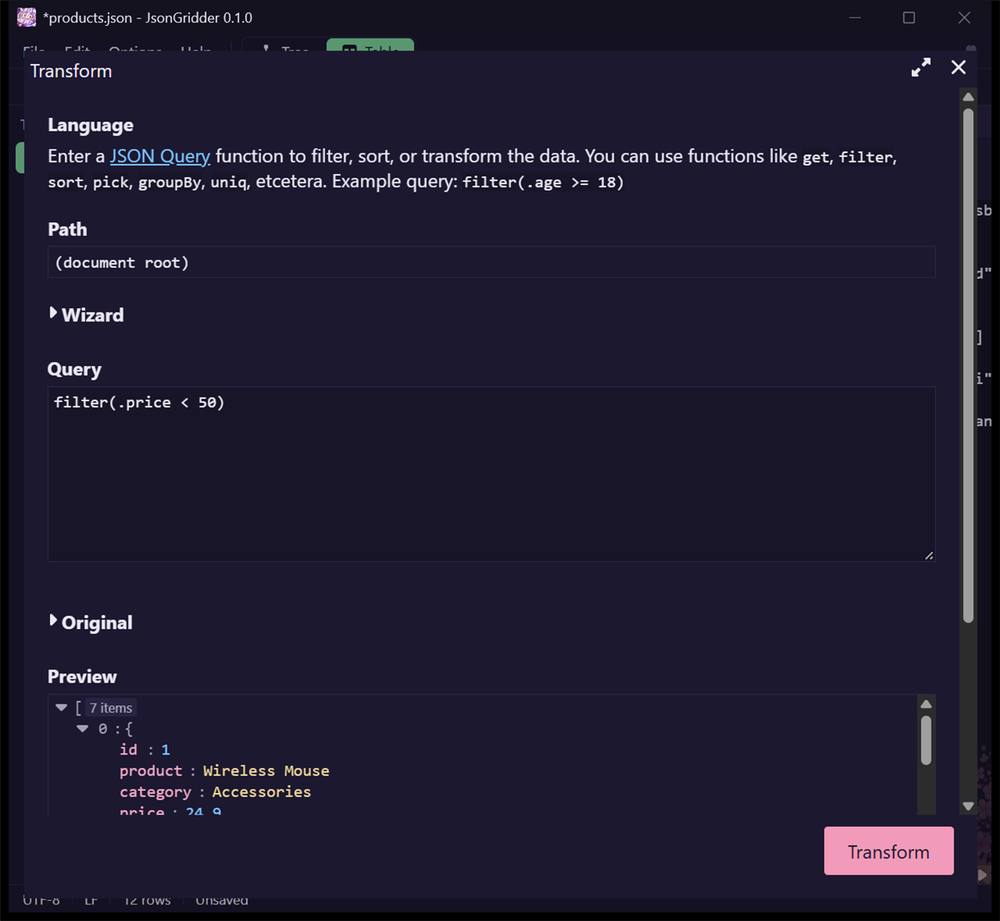
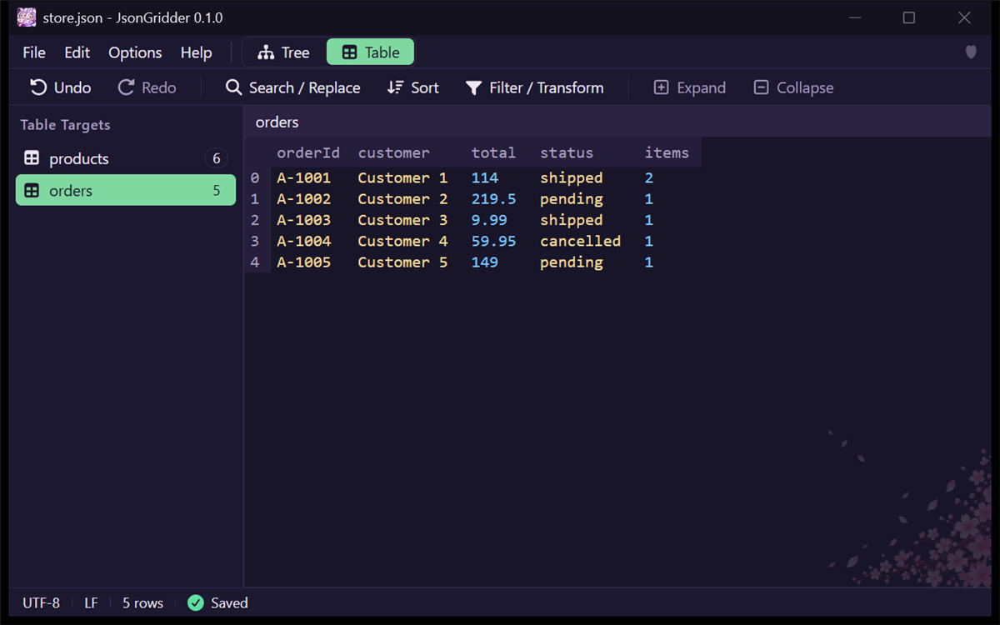
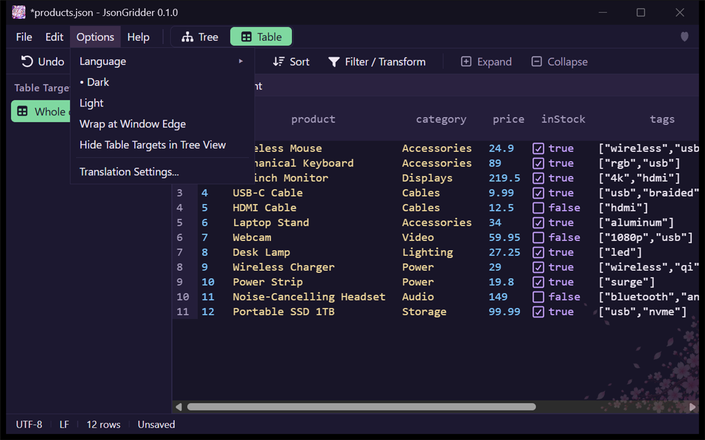
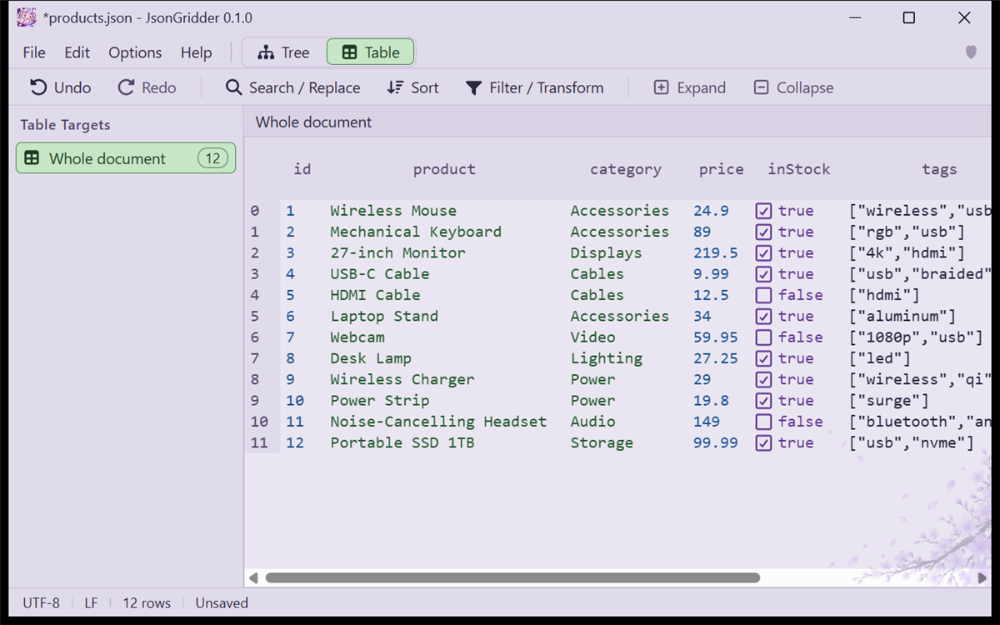

# JsonGridder user guide

This guide walks through the main things you can do with JsonGridder. The screenshots use the dark theme and a made-up product list. You can open the same files from [`samples/products.json`](samples/products.json) and [`samples/store.json`](samples/store.json).

## Opening a file

Choose **File > Open...** (Ctrl+O), drop a file on the window, or pass the path on the command line. **File > Open Recent** lists files you opened before.

## The window

From top to bottom, the window has:

1. The menu bar: **File**, **Edit**, **Options**, **Help**, and the **Tree** and **Table** buttons that switch the view.
2. The command row: **Undo**, **Redo**, **Search / Replace**, **Sort**, **Filter / Transform**, **Expand**, and **Collapse**. Expand and Collapse work in the Tree view.
3. A warning band, only for documents that the table and tree cannot hold (see below).
4. The left pane **Table Targets**, the editor, and the location row, which shows the path of the selected value.
5. The status row: the character encoding (with a note when the file has a BOM), the line endings, the number of rows in the Table view, and **Saved**, **Unsaved**, or **Saving is stopped**.

## The Tree and Table views

Files open in the **Tree** view. Use the **Tree** and **Table** buttons at the right of the menu bar to switch. Both show the same document.

The tree view shows the nested structure, and you can expand and collapse each part.

The table view shows an array of objects with one row per object and one column per key. When the objects have nested objects, such as `supplier.name` and `supplier.city` in `products.json`, the header has two rows: `supplier` above, and `name` and `city` below it.

## Documents that open as text

A document that cannot be read as JSON, has a duplicate key, has the key `__proto__` or `constructor`, or is nested too deeply cannot be held by the table and tree views without losing something. Such a document opens as plain text, with a warning band above it that says why and on which line. The Tree and Table buttons cannot be pressed until the text is fixed. When the problem is gone, the band disappears and you can switch to the Tree or Table view.

## Editing cells

In the table view, click a cell and type to replace its value, or press Enter to edit the existing value. Press Enter again to commit the change. To work on arrays inside a row, such as `tags`, use the tree view.

The **Edit** menu has **Undo**, **Redo**, **Cut**, **Copy**, **Paste**, and **Find / Replace**, which do the same as the keys and the right-click menu. **Open in Text Editor** opens the file in the Windows default app for `.txt` files. If you have unsaved changes, the app first asks whether to save, because the text editor shows what is on disk.

## Undo and redo

Press Ctrl+Z to undo and Ctrl+Y (or Ctrl+Shift+Z) to redo, or use **Undo** and **Redo** in the command row. A single Ctrl+Z also undoes a whole Replace All.

## Search and replace

Press Ctrl+F to open the search box, or Ctrl+H for search and replace. The arrow at the left of the box shows or hides the replace row. The box shows how many matches there are. Replace changes one match at a time, and All replaces every match at once.

## Sorting, filtering and transforming

The **Sort** button in the command row opens a dialog where you choose the property to sort by and the direction.

The **Filter / Transform** button opens a dialog where you write a query to filter, sort, or reshape the data. The preview below the query shows the result before you apply it. For example, `filter(.price < 50)` keeps only the items cheaper than 50.

## Choosing which array to show as a table

The left pane **Table Targets** lists the arrays in the document that can be shown as a table, such as `products` and `orders` in `store.json`, each with its number of items. When the document itself is an array, it comes first as **Whole document**. Click an item to show that array as the table; in the Tree view, clicking an item switches to the Table view.

Turn on **Options > Hide Table Targets in Tree View** to hide the pane while the Tree view is shown. The pane still appears in the Table view.

## Saving and unsaved changes

Use **File > Save** (Ctrl+S) or **File > Save As...** (Ctrl+Shift+S). Saving is atomic, and the app asks before it overwrites a file that changed on disk after you opened it. If you close the window, open another file, or exit while there are unsaved changes, the app asks you first.

## Files changed by another app

When you come back to the JsonGridder window and another app has changed the open file, JsonGridder reloads it. If you have unsaved changes, it asks first: **Reload** discards your edits and loads the file, and **Keep My Edits** keeps them; when you then save, you are asked whether to overwrite. If the file was moved or deleted, the app tells you once, and asks whether to create it again when you save.

## Translation

Translation is off until you turn it on, and while it is off, nothing is sent anywhere.

To turn it on, choose **Options > Translation Settings...**, check **Enable translation**, paste a Gemini API key from Google AI Studio into **Free-tier key (project without billing)** or **Paid key (project with billing)** (or both), and choose **Save Key** and **Save**. The keys are stored in the Windows Credential Manager, not in the settings file, and are not shown again. A key saved by an earlier version appears as **Earlier key (choose where to move it)** until you move it to one of the two fields.

Then right-click a column header, a table cell, or a text value in the tree, point to **Translate to English**, and choose **Paid** or **Free** in its submenu (in the Japanese UI, 日本語に翻訳 > 有料 / 無料; the target is the UI language). The submenu lists only the keys you saved, even if there is just one; Paid and Free are shown in different text colors. With no key saved, the item has no submenu and opens Translation Settings. From the keyboard, Right Arrow or Enter opens the submenu, and Left Arrow or Esc closes it. Only text values are sent; numbers, true/false, null, and empty strings are not. Before anything is sent, a dialog shows the number of values and characters, the service and model, which key is used, and on the free tier a warning. **Cancel** is the default.

The translations appear in a side panel next to the originals, with a line saying which key was used. The note that translations are machine guesses has a **Don't show again** button; **Show the note in the result panel** in Translation Settings brings it back. You can copy one translation, all translations, or the originals with the translations. If translation stops, the rows translated so far stay, and **Translate the rest** sends only the remaining rows. After translating a column, **Add translations as a new column** adds a key next to the original, such as `product_en`, in one edit that one Ctrl+Z takes back. It never overwrites an existing key or changes the original values.

On the Gemini API free tier, Google uses the text you send and the translations to improve its products, and people may read them, according to Google's terms. Translate confidential or personal information with the paid key. On the paid API, they are not used to improve Google's products. Google decides which applies from whether billing is enabled for the key's project, not from anything this app sends, so the app keeps two keys and uses the one you choose. In the EEA, Switzerland, and the UK, only the paid API may be used.

The request goes from the app itself to `generativelanguage.googleapis.com` over HTTPS. The web content in the window is not allowed to connect to the internet.

## Themes and language

Open the **Options** menu to switch between the dark and light themes and between English and Japanese. The app remembers your choice in `JsonGridder.settings.json` next to the EXE.

Turn on **Options > Wrap at Window Edge** to wrap long text in table cells within the column width, so you can read a long value without scrolling sideways; the last column reaches the right edge of the window. Drag the border between two column headers to change a column's width. Widths are kept while the file is open.

Here is the table in the light theme.

## Keyboard shortcuts

| Shortcut | Action |
| --- | --- |
| Ctrl+O | Open a file |
| Ctrl+S | Save |
| Ctrl+Shift+S | Save As |
| Ctrl+Z | Undo |
| Ctrl+Y, or Ctrl+Shift+Z | Redo |
| Ctrl+F | Search |
| Ctrl+H | Search and replace |
| Enter | Commit the edit in a cell |
| Alt, or F10 | Move to the menu bar |
