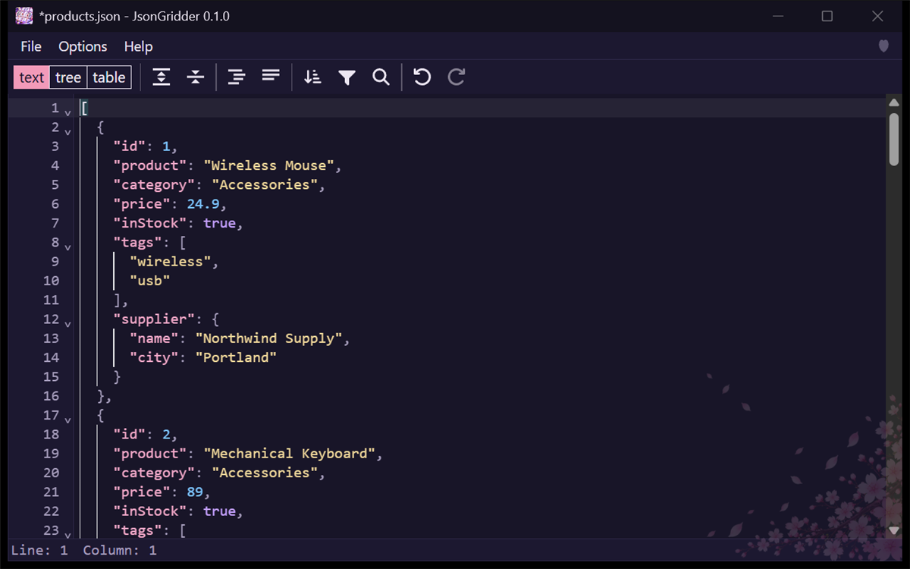

# JsonGridder user guide

This guide walks through the main things you can do with JsonGridder. The screenshots use the dark theme and a made-up product list. You can open the same files from [`samples/products.json`](samples/products.json) and [`samples/store.json`](samples/store.json).

## Opening a file

Choose **File > Open...** (Ctrl+O), drop a file on the window, or pass the path on the command line. **File > Open Recent** lists files you opened before.

## The three views

Use the buttons at the top of the editor to switch between **table**, **tree**, and **text**. All three show the same document. An array of objects opens as a table, with one row per object and one column per key.

The tree view shows the nested structure, and you can expand and collapse each part.

The text view shows the JSON as plain text, so you can edit it directly.

## Editing cells

In the table view, click a cell and type to replace its value, or press Enter to edit the existing value. Press Enter again to commit the change. To work on nested values such as `tags` or `supplier`, use the tree view or the text view.

## Undo and redo

Press Ctrl+Z to undo and Ctrl+Y to redo. A single Ctrl+Z also undoes a whole Replace All.

## Search and replace

Press Ctrl+F to open the search box, or Ctrl+H for search and replace. The arrow at the left of the box shows or hides the replace row. The box shows how many matches there are. Replace changes one match at a time, and All replaces every match at once.

## Sorting, filtering and transforming

The **Sort** button opens a dialog where you choose the property to sort by and the direction.

The **Transform** button opens a dialog where you write a query to filter, sort, or reshape the data. The preview below the query shows the result before you apply it. For example, `filter(.price < 50)` keeps only the items cheaper than 50.

## Choosing which array to show as a table

When a document has several arrays inside it, such as `products` and `orders` in `store.json`, the table view shows a bar above the table with the current **Table target**. Click it and choose another array, or choose **Whole document**.

## Saving and unsaved changes

Use **File > Save** (Ctrl+S) or **File > Save As...** (Ctrl+Shift+S). Saving is atomic, and the app asks before it overwrites a file that changed on disk after you opened it. If you close the window, open another file, or exit while there are unsaved changes, the app asks you first.

## Themes and language

Open the **Options** menu to switch between the dark and light themes and between English and Japanese. The app remembers your choice in `JsonGridder.settings.json` next to the EXE.

Turn on **Options > Wrap at Window Edge** to wrap long text in table cells within the column width, so you can read a long value without scrolling sideways; the last column reaches the right edge of the window. Drag the border between two column headers to change a column's width. Widths are kept while the file is open.

Here is the table in the light theme.

## Keyboard shortcuts

| Shortcut | Action |
| --- | --- |
| Ctrl+O | Open a file |
| Ctrl+S | Save |
| Ctrl+Shift+S | Save As |
| Ctrl+Z | Undo |
| Ctrl+Y | Redo |
| Ctrl+F | Search |
| Ctrl+H | Search and replace |
| Enter | Commit the edit in a cell |
| Alt, or F10 | Move to the menu bar |
